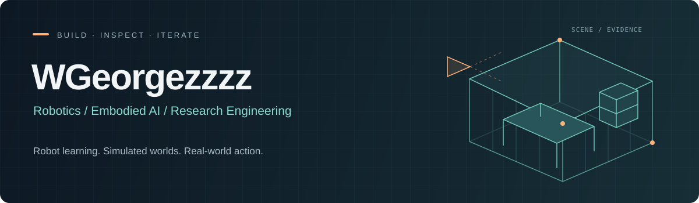

  

  <b>WGeorgezzzz</b> 
  From perception and learning to action in the real world. 
  从感知与学习，到真实世界中的行动。

  <a href="https://github.com/Roboparty">RoboParty</a> ·
  <a href="#selected-work--公开项目">Selected work</a> ·
  <a href="#research--engineering--研究与工程">Research &amp; Engineering</a> ·
  <a href="#toolbox--技术栈">Toolbox</a> ·
  <a href="https://github.com/WGeorgezzzz/WGeorgezzzz/issues">Get in touch</a>

---

### About / 关于我

A robotics developer at **RoboParty**. I work on **robot learning, vision-language-action models, whole-body manipulation, simulation, and research tooling**.

我的工作覆盖数据采集、模型训练、策略评估与机器人系统集成，关注 VLA、世界模型与 JEPA、全身动作生成，以及 Real2Sim。

我希望把模型、仿真和真实机器人连起来，也让研究过程能够被检查、复现和持续迭代。

| Robot learning | Simulation & data | Research engineering |
| :--- | :--- | :--- |
| VLA · World models · Whole-body skills | Real2Sim · Scene generation · Demonstration collection | Evaluation · Experiment lineage · AI agents |

### Selected work / 公开项目

#### 01 · Real2Sim — From images to editable scenes

将真实照片转成可编辑的三维场景，连接相机信息、部件建模、局部修订与仿真检查。

My public contributions include calibrated multi-view reconstruction, geometry and texture repair, and comparisons with preserved evaluation evidence.

项目公开案例：Desk1 源图与重建对照；具体条件和评测范围见项目说明。

**[Repository ↗](https://github.com/Roboparty/gpt-6-astra-real2sim-workflow)** · [My contributions](https://github.com/Roboparty/gpt-6-astra-real2sim-workflow/commits?author=WGeorgezzzz)

`Python` `Blender` `MuJoCo` `USD / GLB` `Camera calibration`

#### 02 · LabWeft — Weave experiments into understanding

把散落在代码、日志和报告里的研究过程，整理成可追溯的研究地图：问题、对照条件、运行记录，以及支撑结论的证据。

I contribute to research organization and run-level lineage visualization, making experimental relationships easier to inspect.

项目公开界面：研究问题、实验对照与来源关联。

**[Repository ↗](https://github.com/Roboparty/LabWeft)** · [My contribution](https://github.com/Roboparty/LabWeft/pull/2)

`Python` `JavaScript` `Research tooling` `Experiment lineage`

### Research & Engineering / 研究与工程

我参与开发的机器人系统、仿真平台与数据工具。非公开项目仅作文字介绍。

#### RPArena · 全身动作与任务评测

围绕人形与移动操作机器人构建统一任务执行和评测链路，推进 G1＋Dex3、RP1、Luna 与 Piper 等平台的动作、场景和采集接口整合。工作涵盖导航、到站抓取、搬运、放置与释放，以及任务重置、评分、日志和回放；分别检查动作规划、接触、物体保持和最终任务结果。

`Whole-body Control` `Manipulation` `Isaac Sim / Isaac Lab` `Task Evaluation`

#### RoboHouseGen · 场景生成与资产底座

推进面向机器人任务的室内场景生成、家具资产组织与场景包标准化，将场景构建和机器人接入分离。工作涉及布局与装配、资产语义与材质、可交互部件、质量检查，以及与 RPArena 的接口，让操作任务、专家动作和数据采集复用一致的环境。

`Scene Generation` `Asset Pipelines` `Articulated Objects` `Simulation`

#### INTACT · 示范数据与策略评估

围绕 Piper 与 RoboTwin / ALOHA 操作任务，推进仿真示范采集、域随机化、多视角观测，以及图像、实测状态和动作的数据对齐。连接数据导出、质量检查与策略闭环评估，关注训练输入和部署接口的一致性，以及失败轨迹的保留与分析。

`Demonstration Data` `Domain Randomization` `HDF5` `Policy Evaluation`

### Toolbox / 技术栈

| Area | Tools & focus |
| :--- | :--- |
| Programming | Python · JavaScript |
| Robot learning | VLA · OpenVLA-OFT · RLinf · World models / JEPA |
| 3D & simulation | Isaac Sim / Isaac Lab · MuJoCo · Blender · RoboTwin / SAPIEN · USD / GLB |
| Data & systems | Demonstration collection · Domain randomization · HDF5 · FastAPI · MCP |
| Research workflows | Git / GitHub · AI coding agents · Reproducible evaluation |

---

  Interested in robot learning, simulation, or research tooling? Let's compare notes. 
  欢迎交流机器人学习、具身智能与系统实践。 
   
  <a href="https://github.com/WGeorgezzzz/WGeorgezzzz/issues">Public contact / 公开交流</a> ·
  <a href="https://github.com/Roboparty">Explore RoboParty</a>

